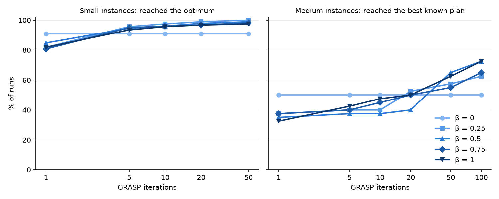
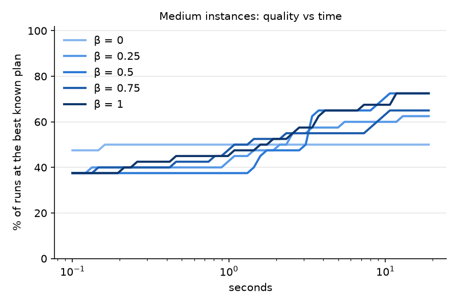

# Person 2: GRASP heuristic for Model R

Everything Person 2 builds lives in this folder. It uses only two things from
the rest of the repo:

- **the data** in `data/` (Madrid, Edmonton, Fez-Meknes)
- **Person 1's Model R code**: the `Instance` object (`src/ambulance/instance.py`)
  and, for checking only, the Gurobi solver (`src/ambulance/model.py`, `solve_robust`)

The model itself is in `reports/Model_R_Formulation.pdf`.

## Files

| File | What it does | Status |
|---|---|---|
| `scoring.py` | Scores a plan: the four goals of Model R and the 3 hard rules. `PlanState` scores small changes fast (same keys) | ✅ done, checked |
| `instances.py` | Loads a map and draws a random situation, for testing only (Person 3 will make the official instances) | ✅ done |
| `checks/check_scoring.py` | Proves `scoring.py` agrees with Gurobi and with brute force | ✅ 55/55 OK |
| `checks/check_fast_scoring.py` | Proves the fast `PlanState` gives exactly the same keys as `key()` | ✅ 5028/5028 identical |
| `construction.py` | GRASP construction: place ambulances one at a time, picking at random from the RCL of the best placements. `greedy()` = β = 0 | ✅ done |
| `checks/check_construction.py` | Greedy vs Gurobi; validity, diversity and best-of-20 for each β; runtime on medium instances | ✅ always valid, greedy optimal 26/55, < 1 s |
| `local_search.py` | Local search: MOVE one ambulance or SWAP two, keep only improvements, stop at a local optimum. First or best improvement | ✅ done |
| `checks/check_local_search.py` | Valid / never worse / true local optimum; greedy + local search vs Gurobi; best-of-20 per β; medium runtime | ✅ 660/660 correct, optimal 50/55, < 0.5 s |
| `grasp.py` | **The heuristic**: `grasp(inst, beta, iterations, time_limit, seed, mode)` repeats construction + local search and returns the best plan, its goals, runtime and an improvement history | ✅ done |
| `checks/check_grasp.py` | Valid, reproducible, time limit; optimal vs number of iterations; medium runtime | ✅ 55/55 optimal from 50 iterations |
| `tests/` | pytest tests, no Gurobi needed (about 5 s): goals checked by hand on a tiny 3-base map, Model R's strict order, edge cases, GRASP = brute force on 30 instances | ✅ 49/49 pass |
| `experiment/run_experiment.py` | The β / iterations experiment: every β × 5 seeds on 55 small + 8 medium instances; saves `results/runs.csv` and `results/history.csv` | ✅ done (about 30 min) |
| `report/heuristic_design.tex` (+ `.pdf`) | Report section 3, Heuristic Design: method, construction and RCL, moves, acceptance, parameters, validation and choice of β. Same notation as Model R's formulation | ✅ draft done |
| `experiment/make_plots.py` | Tables (`results/tables.md`) and plots (`results/*.png`) from the saved results | ✅ done |

## β / iterations experiment (`experiment/`)

**Setup.** β ∈ {0, 0.25, 0.5, 0.75, 1}, 5 seeds each, first-improvement local search.
One GRASP run per (instance, β, seed); its improvement history gives the best plan after
any number of iterations or seconds (fewer iterations with the same seed = the first
iterations of the same run).

- **Small**: the 55 instances above, 50 iterations, compared with **Gurobi's optimum**.
- **Medium**: 8 instances (3 on Fez case 1 with 18 ambulances, 2 on Fez case 2 with 22,
  3 on Edmonton with 20), 100 iterations. The optimum is unknown (Gurobi pip licence too small),
  so each run is compared with the **best known plan** = the best plan found by any of its 25 runs.

**Small instances: % of runs that reach the optimum**

| β | 1 it. | 5 it. | 10 it. | 20 it. | 50 it. |
|---|---|---|---|---|---|
| 0 | 91% | 91% | 91% | 91% | 91% |
| 0.25 | 82% | 96% | 97% | 99% | **100%** |
| 0.5 | 85% | 95% | 96% | 98% | 99% |
| 0.75 | 81% | 95% | 96% | 97% | 98% |
| 1 | 82% | 93% | 96% | 97% | 97% |

**Medium instances: % of runs that reach the best known plan**

| β | 1 it. | 5 it. | 10 it. | 20 it. | 50 it. | 100 it. |
|---|---|---|---|---|---|---|
| 0 | 50% | 50% | 50% | 50% | 50% | 50% |
| 0.25 | 38% | 40% | 40% | 52% | 58% | 62% |
| 0.5 | 35% | 38% | 38% | 40% | 65% | 72% |
| 0.75 | 38% | 40% | 45% | 50% | 55% | 65% |
| 1 | 32% | 42% | 48% | 50% | 62% | 72% |

**Medium instances after 100 iterations: where the other runs lose** (40 runs per β;
"goal k" = first goal that is worse than the best known plan)

| β | equal to best | goal 1 | goal 2 | goal 3 | goal 4 | avg goal-4 gap | max goal-4 gap |
|---|---|---|---|---|---|---|---|
| 0 | 20 | 0 | 0 | **10** | 10 | 0.31% | 1.80% |
| 0.25 | 25 | 0 | 0 | 0 | 15 | 0.11% | 0.57% |
| 0.5 | 29 | 0 | 0 | 0 | 11 | 0.14% | 2.40% |
| 0.75 | 26 | 0 | 0 | 0 | 14 | 0.15% | 2.40% |
| 1 | 29 | 0 | 0 | 0 | 11 | 0.09% | 0.57% |

Average runtime of 100 iterations on the medium instances: 4.5 s for β = 0, about 8 s for β > 0
(more varied starts need more local search). Edmonton about 4 s, Fez case 1 about 7 s, Fez case 2 about 13 s.




**What it shows**

1. **β = 0 (greedy) never improves with more iterations**: construction is deterministic, so every
   iteration rebuilds the same plan. It is the best choice for exactly 1 iteration, but on medium
   instances it is the only setting that loses on a **higher-priority goal** (goal 3, extra moves).
2. **Any β > 0 keeps improving with more iterations**, and overtakes greedy after about 5 iterations
   (small) or between 20 and 50 iterations (medium). This is the reason GRASP adds randomness.
3. **No run with β > 0 is ever worse on goals 1-3** than the best known plan. They differ only on
   coverage (goal 4), on average by 0.1-0.15%.
4. **Between β > 0 the differences are small.** β = 0.25 is the only one that reaches the optimum in
   100% of the small runs and has the smallest worst case on medium (0.57%); β = 0.5 and 1 reach
   the best known plan a little more often on medium (72% vs 62%), but with only 8 medium instances
   that difference is a few runs. **Default: β = 0.25.**
5. **Iterations**: 50 are enough on small instances. On medium instances the curves are still
   rising at 100, so more iterations (or a time limit of a few tens of seconds) still pay off.

**Limit**: on medium instances "best known" is not a proven optimum; the academic Gurobi licence
would let us check it.

## Tests (`tests/test_person2.py`)

| Group | What is tested |
|---|---|
| Scorer by hand | On a tiny 3-base, 2-area map (`tests/conftest.py`) every goal is worked out by hand: coverage, 2T rule, overtime, extra moves, the 3 hard rules; fast scorer = `key()` for every plan |
| Strict order | Goal 1 beats overtime (an ambulance with no shift left still moves if that fixes the 2T rule); overtime beats coverage |
| Edge cases | No free ambulances; one ambulance; ambulance at a sleeping base (forced move, counted); only one free spot left; no valid plan → clear error; bad β or mode → clear error; tied scores |
| GRASP behaviour | β = 0 equals greedy; same seed = same plan; local search never makes a plan worse; time limit stops the search; GRASP finds the brute-force optimum on 30 random small instances |

## Construction results (55 small instances, 20 runs each)

| β | different plans (of 20) | best of 20 optimal |
|---|---|---|
| 0 (greedy) | 1.0 | 26/55 |
| 0.25 | 15.9 | 25/55 |
| 0.5 | 18.3 | 13/55 |
| 0.75 | 19.0 | 6/55 |
| 1 (random) | 19.3 | 4/55 |

Randomness alone does not beat greedy: the RCL brings in variety, but also worse placements.
That is expected in GRASP: construction gives **different starting points**, and local search
(next step) turns them into good plans. Whether β > 0 then pays off is the β sensitivity
experiment.

## Local search results (same 55 instances)

| Method | optimal |
|---|---|
| greedy | 26/55 |
| greedy + local search (first improvement) | 50/55 |
| greedy + local search (best improvement) | 49/55 |
| best of 20 × (construction + local search), β = 0.25 | **55/55** |
| same, β = 0.5 / 0.75 / 1 | 51 / 54 / 52 of 55 |

With local search, a little randomness (β = 0.25) beats pure greedy: this is why GRASP repeats
construction + local search from different random starts.

## GRASP results (β = 0.25)

Optimal on the 55 small instances, 3 seeds:

| iterations | 1 | 5 | 10 | 20 | 50 |
|---|---|---|---|---|---|
| optimal (of 55) | 45, 44, 45 | 52, 52, 52 | 54, 54, 53 | 54, 55, 55 | 55, 55, 55 |

Runtime of 100 iterations on medium instances, before → after the speed-up:

| instance | ambulances | before | after |
|---|---|---|---|
| Fez case 1 (18 bases) | 18 | 17 s | 6.5 s |
| Fez case 2 (22 bases) | 22 | 38 s | 13.4 s |
| Fez case 3 (40 bases) | 33 | 304 s | 112 s |
| Edmonton (16 bases) | 20 | 10 s | 4.4 s |

**Speed-up (incremental scoring):** `PlanState` remembers the counts of the current plan, so a
move or swap only updates what it touches, and goal 4 is skipped when goals 1-3 already show
a change is worse. The plans found are **identical** to the plain version
(495/495 GRASP runs compared, plus `checks/check_fast_scoring.py`: 5028/5028 identical keys).
The time limit is still checked between iterations (one iteration on Fez case 3 takes about 1 s).

## Key ideas

**A plan** is a dict `{ambulance i: base j}`, numbered from 0. Example: `{0: 4, 1: 4, 2: 7}`.

**Valid plan** = the 3 hard rules of Model R hold:
(1) every ambulance has one base, (6) no ambulance goes to a sleeping base, (3) no base over capacity.

**Better plan** = smaller `key(inst, plan) = (f1, f2, f3, -f4)`:

| Goal | Meaning | Direction |
|---|---|---|
| f1 | areas in V2 with no ambulance within 2T (60 min) | minimise |
| f2 | overtime minutes | minimise |
| f3 | moves above the free allowance M | minimise |
| f4 | expected coverage within T, minus moving cost and uncovered penalty | maximise |

Python compares tuples element by element, so `key(A) < key(B)` compares goal 1 first,
then goal 2, and so on: exactly Model R's strict order.

**Naming:** the GRASP greediness parameter is called **β** (0 = pure greedy, 1 = pure random),
because α is already used in Model R for the 2T reliability (0.97).

## Run

From the repo folder, once:

```bash
python -m venv .venv && .venv/bin/pip install -r requirements.txt
```

Run the tests (about 5 seconds, no Gurobi needed):

```bash
.venv/bin/python -m pytest person2/tests -v
```


Run the checks (a few minutes each):

```bash
.venv/bin/python person2/checks/check_scoring.py
```

```bash
.venv/bin/python person2/checks/check_fast_scoring.py
```

```bash
.venv/bin/python person2/checks/check_construction.py
```

```bash
.venv/bin/python person2/checks/check_local_search.py
```

```bash
.venv/bin/python person2/checks/check_grasp.py
```

Run the β / iterations experiment (about 30 minutes), then make its tables and plots:

```bash
.venv/bin/python person2/experiment/run_experiment.py
```

```bash
.venv/bin/python person2/experiment/make_plots.py
```

## Data notes

- Fez-Meknes has no base capacities: `instances.py` uses C_j = 2 (Model R default) unless told otherwise.
- The Fez-Meknes base-to-base file gives 3 min from a base to itself; Model R needs 0, so `load_map` sets it to 0.
- Gurobi's free pip licence is size-limited (2000 variables or constraints): enough for small checks only.
